<p align="center">
  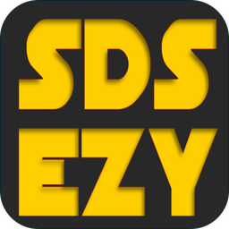
</p>

# SDS EZY

SDS EZY is a chemical register with a hazard risk assessment for each chemical. It makes a job nobody wants to do easy: someone uploads a safety data sheet (SDS), the app reads it, drafts the risk assessment and adds the lot to the register. It runs entirely on Cloudflare (a Worker for the code, D1 for the database, R2 for the PDFs), so there is no server to look after.

It is built for people who work out on other people's sites as well as in a workshop: products are mostly kept in vehicles and come out at the point of use, and that is when the SDS and the risk assessment need to be at hand. It works best on a phone.

It does one job: **the chemical register and the risk assessment for each chemical.** Work instructions, SOPs, JSEAs and SWMS are out of scope; they belong in a different product.

## Live demo

**Try it: https://sds-ezy-demo.max-christensen.workers.dev**

It is a read-only demo for a made-up business, Tallowood Joinery & Maintenance Pty Ltd, with 67 chemicals and generated, clearly fictional safety data sheets. Nothing in it is real and nothing can be changed. On the login screen use the one-click buttons, or type a login:

| Role | Email | Password |
|---|---|---|
| Administrator | `demo-admin@example.invalid` | `demo-Ezy-2026` |
| User | `demo-user@example.invalid` | `demo-Ezy-2026` |

The password is public on purpose and exists only for the demo. Screenshots below are from the live demo.

| Desktop | Phone |
|---|---|
| 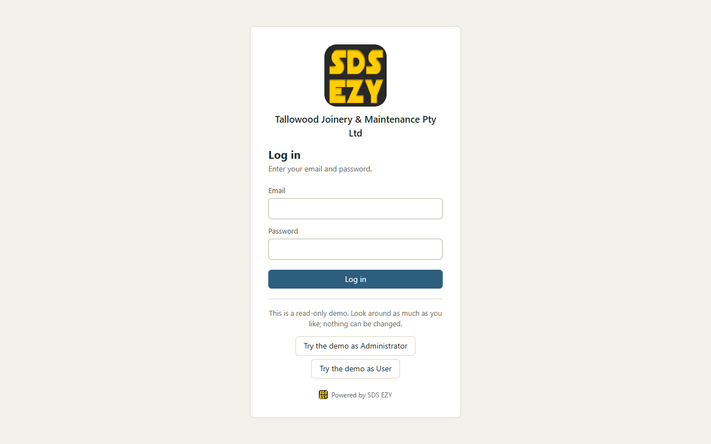 | 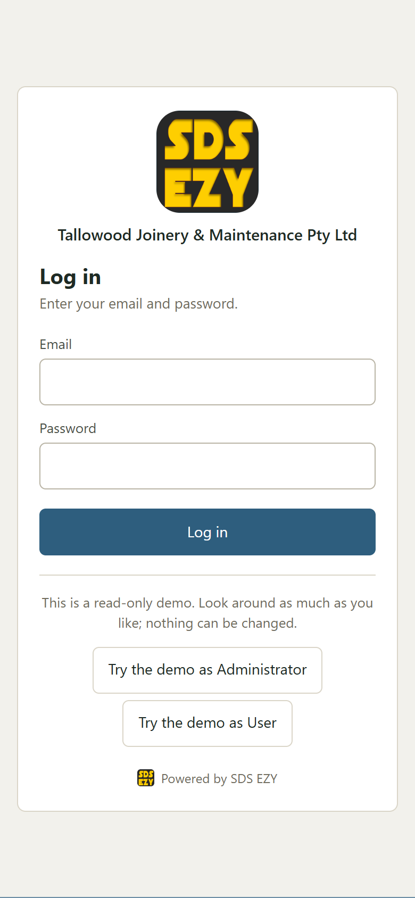 |
| 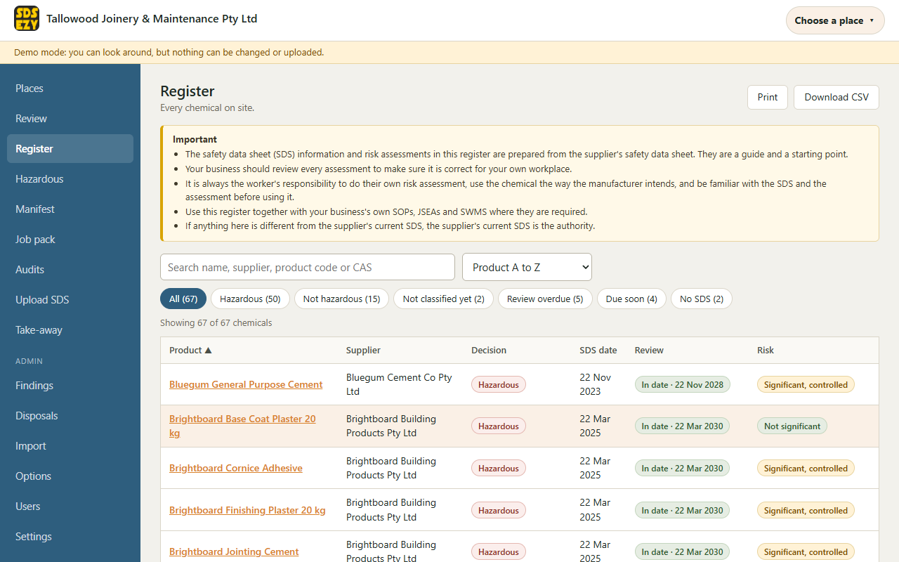 | 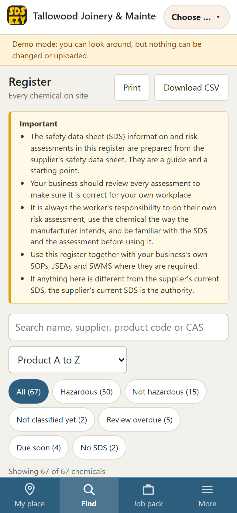 |
| 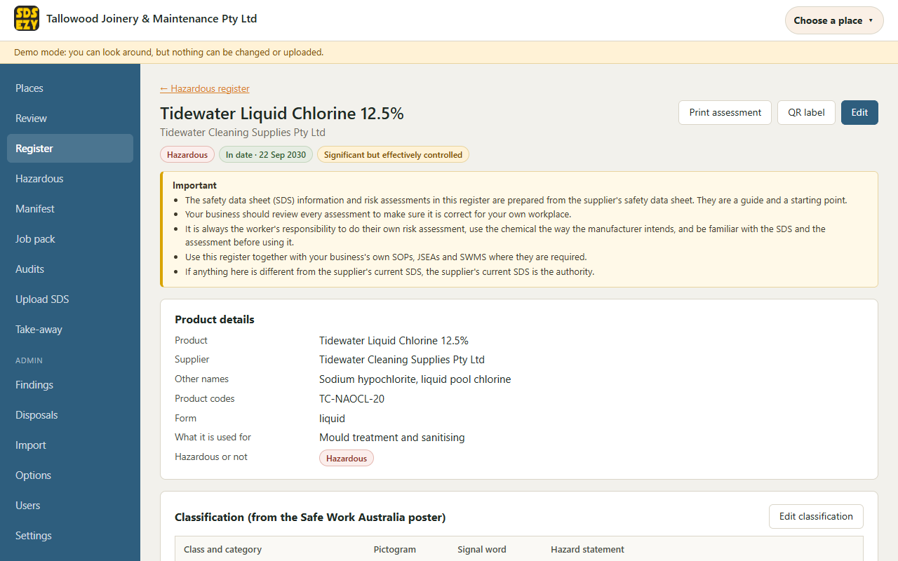 | 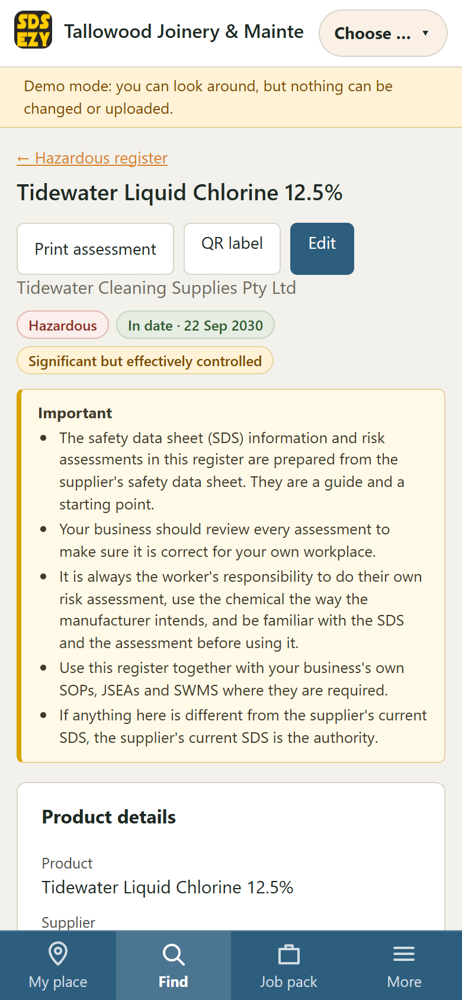 |
| 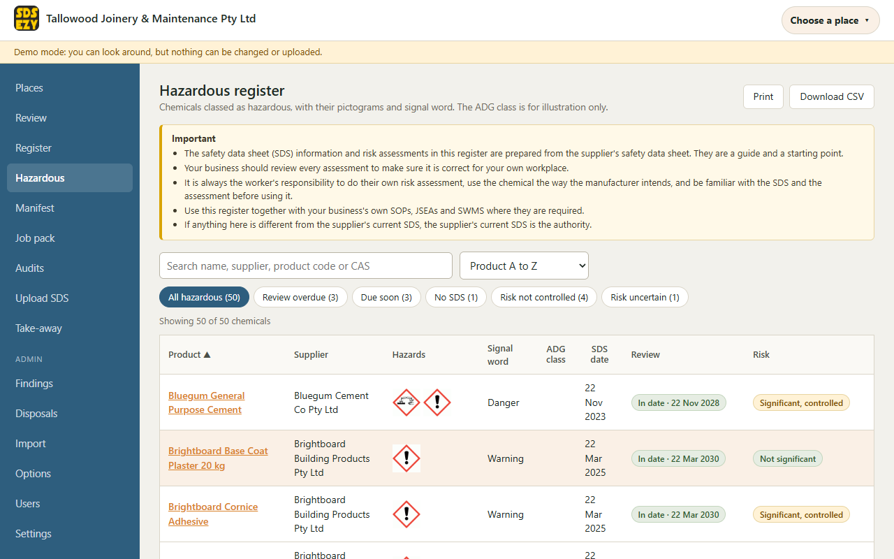 | 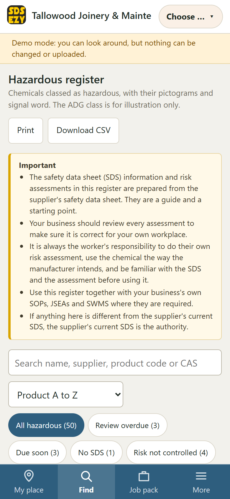 |
| 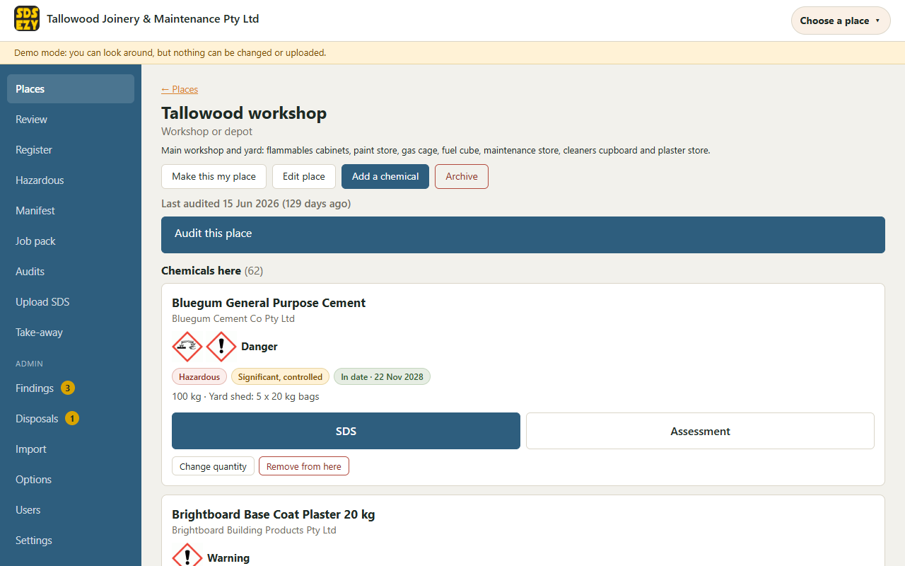 | 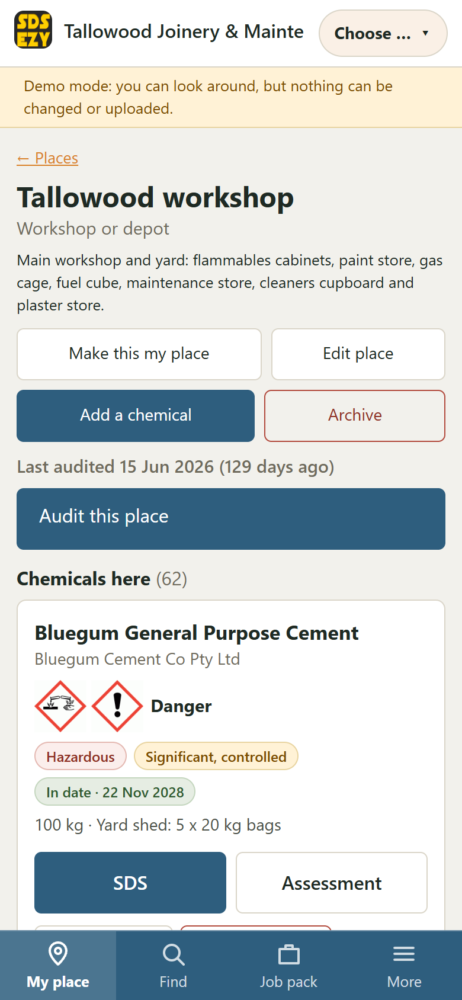 |
| 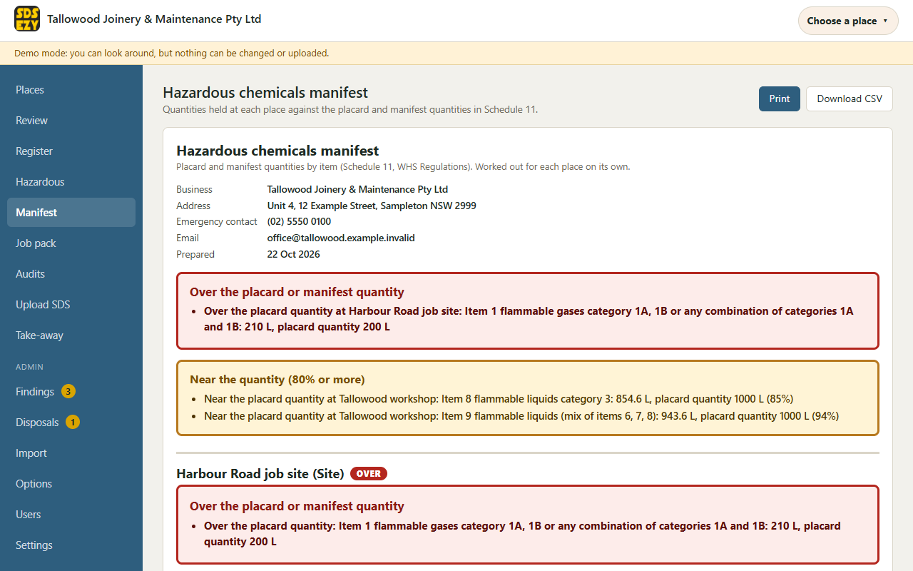 | 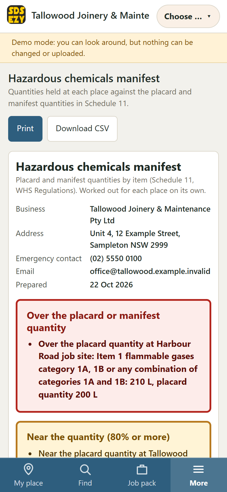 |
| 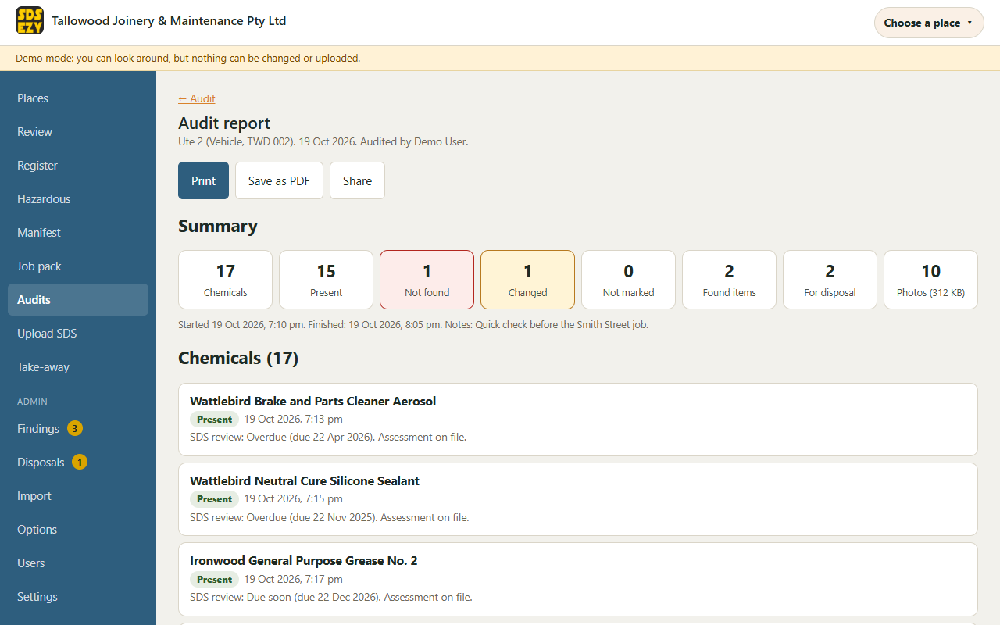 | 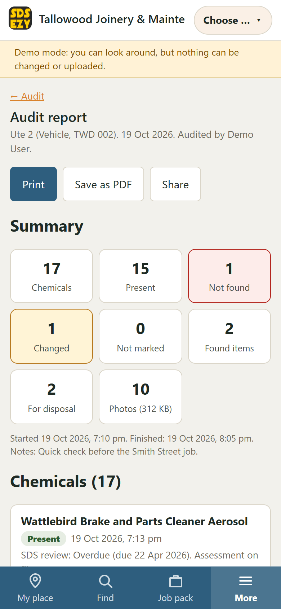 |
| 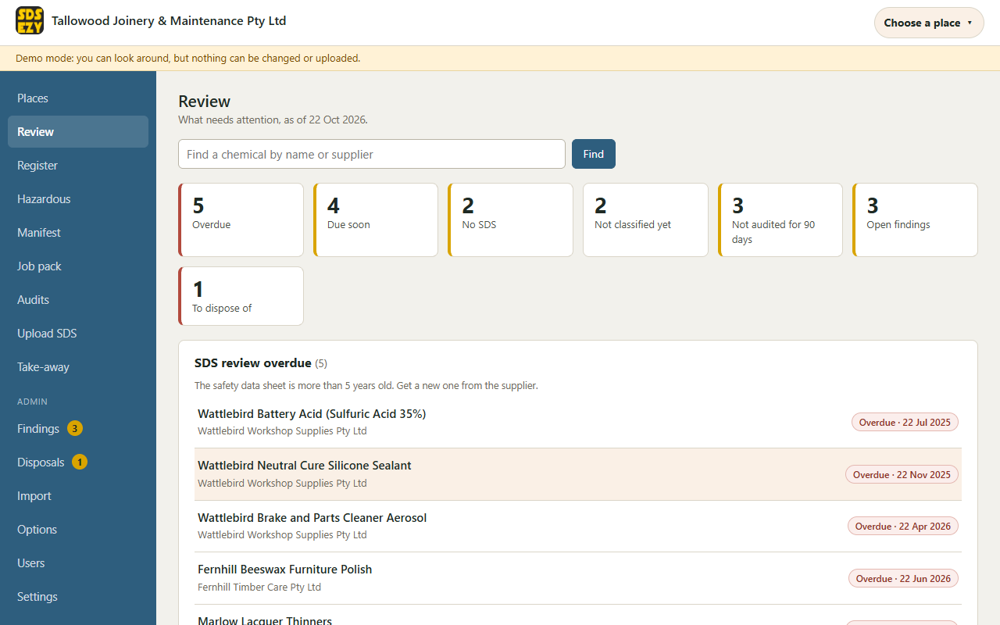 | 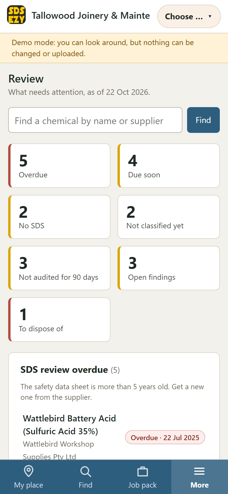 |

## Important: read this first

> The safety data sheet (SDS) information and risk assessments in this register are prepared from the supplier's safety data sheet. They are a guide and a starting point.
>
> Your business should review every assessment to make sure it is correct for your own workplace.
>
> It is always the worker's responsibility to do their own risk assessment, use the chemical the way the manufacturer intends, and be familiar with the SDS and the assessment before using it.
>
> Use this register together with your business's own SOPs, JSEAs and SWMS where they are required.
>
> If anything here is different from the supplier's current SDS, the supplier's current SDS is the authority.

The app shows this on the register, the chemical and assessment pages, every printed assessment, the manifest, every export and the first-run welcome. The wording lives in one file, [public/disclaimer.js](public/disclaimer.js), so it can be changed everywhere at once; this README carries a copy, so keep the two in step. **A lawyer should review the final wording before you rely on it.**

## What it does

- **Upload an SDS and you're done.** Pick the PDF. Your browser reads the text out of it (so the Worker spends no time parsing PDFs), you answer five quick questions the SDS can't answer (where and how it is used, whether it is sprayed, roughly how much is held, how long people are exposed, how well ventilated the area is), and an AI turns the lot into a chemical record, an SDS record and a drafted assessment. They go straight into the register. There is no approval step and no reviewer field.
- **Checked against the PDF.** Anything that has to be exact (UN number, packing group, Hazchem code, dangerous goods class, CAS numbers, dates, poison schedule, emergency phone) is checked against the text of the PDF. If it isn't in the text it is left blank and flagged "not found in the SDS text, check". The classification is checked the same way: a class whose hazard statement isn't in the SDS text is dropped and flagged, and a hazard statement in section 2 that the AI missed is added and flagged. ADG class, UN number and packing group stay as separate fields, because the SDS carries them. The risk level is **Uncertain** unless the SDS and the answers clearly support another level.
- **If the AI isn't set up, or fails, the upload still works.** The entry is created with the PDF attached and an empty draft assessment for the admin to complete by hand.
- **Review-due home screen.** SDS past or near their five-year review, chemicals with no SDS, chemicals with no decision.
- **Classified from the Safe Work Australia poster.** Each chemical's GHS hazard classes and categories are read from SDS section 2 and checked against the hazard statements (H-codes) in the SDS text. The pictograms, the signal word and the hazardous or not hazardous decision are **derived from that classification** using a table built from the poster, with the nine official GHS pictograms. An admin can override a derived pictogram or decision, and an override is always shown. A product carrying none of the classifications is non-hazardous.
- **Registers.** The full register, the hazardous chemicals register, and a manifest. The manifest totals stored quantities for each of the **43 placard and manifest items** in Schedule 11 of the WHS Regulations **per place** (never across the whole business), shows each total against the placard quantity and the manifest quantity, and flags clearly when a place goes over either one (and when it is near). Quantities are worked out by GHS hazard class and category, not by dangerous goods class.
- **A page for each chemical** with its SDS, its classification and the official GHS pictograms, the one-page assessment, the places it is kept with quantities (litres or kilograms), SDS version history, and a printable QR label for cabinets that opens the chemical's page after login.
- **One SDS, many products.** A sheet that covers ten products (or four pack sizes) is stored once and linked to each product. A newer SDS replaces the current one and the old one is kept as history.
- **Non-hazardous chemicals** that have been checked stay on the list with that decision recorded, and don't need a full assessment.
- **Places.** A place is a workshop or depot, a vehicle (with a registration number) or a site. A chemical is kept at one or more places, with an optional quantity. The admin creates, edits and archives places; archived places drop off the active lists but stay on record. Chemicals are not tracked moving between places. Each place has a "counts toward the placard and manifest totals" setting: on for workshops, depots and sites, **off for vehicles** (see the open point below).
- **Pick your place and go.** After signing in, a user picks where they are working (for example "Ute 2"). The app remembers it on that phone and shows that place's chemicals first, with the SDS and the assessment one tap away. Each place has a printable QR label that opens its chemical list after sign-in.
- **Add a chemical from a label photo.** An admin can add a chemical on **Register, Add a chemical** by typing it, or by photographing the product label: the AI (Workers AI by default, so nothing to set up) reads the name, supplier, product code and any signal word or hazard text into the form for them to check and edit. It never saves by itself, and the photo is only kept (in R2, with the chemical) if the chemical is saved. If no AI is set up or the read fails, the form is simply filled in by hand. A **Find SDS** button opens a web search (or, for a few suppliers with a known SDS search page, that page) in a new tab; the app itself looks nothing up. The PDF you download is then uploaded in the normal way and the assessment is drafted as usual. Off in the read-only demo.
- **Job packs.** Anyone signed in can pick a place (or tick chemicals directly), enter the client or site name, a job reference and the date, and get one print-ready PDF built in the browser: a cover page (company details, client or site, date, the list of chemicals and anything that is missing), a register page, then each chemical's assessment followed by its SDS, with the disclaimer on the pages. They can also get a zip of the SDS PDFs. A chemical with no SDS or no assessment is listed on the cover and gets a placeholder page, never left out. Nothing is saved on the server, so it needs no write permission. Many PCBUs ask for these before work starts.
- **On the phone, with or without a signal.** The app can be installed to the home screen. "Save this place for offline" stores that place's chemical pages, assessments and SDS PDFs on the phone and shows when it was last updated, so they open with no signal. Offline is read-only; an upload needs a signal and says so. Signing out clears the saved data. See [docs/OFFLINE.md](docs/OFFLINE.md).
- **Chemical audits.** On a phone or tablet at the place itself, anyone signed in can audit a place: mark each chemical **Present**, **Not found** or **Changed** (a different quantity or container) with a note and a photo, with each chemical's SDS review status and whether it has an assessment shown so out-of-date ones stand out. They can photograph a label to add a **found item** that is not on the register, flag items **for disposal**, and finish to get a summary. Not found and Changed do not change the register by themselves: they become findings an admin accepts or dismisses. Each audit can be printed or saved as a PDF, and the review home lists places not audited for a set number of days. See [Chemical audits](#chemical-audits).
- **Take-it-with-me exports for sites with no internet** (built in the browser, both roles): an Excel file of the register and manifest; one print-ready PDF of the whole register, the manifest, and each assessment followed by its SDS; and a zip of all the SDS PDFs named by product.
- **One-time import** from a spreadsheet (admin).

## Who can do what

There are only two roles, and the Worker enforces them (the screens just match):

| | Admin | User |
|---|---|---|
| Search and read the register, open any SDS, read any assessment | yes | yes |
| Print and export | yes | yes |
| Pick my place, save a place for offline, build a job pack | yes | yes |
| Run an audit, take photos, add a found item, flag an item for disposal | yes | yes (their own audits) |
| Upload an SDS | yes | yes (limited, see below) |
| Edit or delete anything, including their own uploads | yes | no |
| Create, edit and archive places; link chemicals to places and set quantities | yes | no |
| Accept or dismiss audit findings, close disposal items, see every audit and photo, audit settings | yes | no |
| Business details, branding, users, options, imports, settings, AI setup | yes | no |

Because a user can write (by uploading), the upload has guards: PDF only (checked by content, not just the name), a file size cap (15 MB by default), a limit per login per hour (10 by default), and a duplicate check, so uploading an SDS that already exists is offered as a newer version of it and never makes a second copy. The admin can change the size cap and hourly limit in **Settings**.

## Chemical audits

An audit is run against one place (a workshop, a vehicle or a site), usually on a phone, with photos as proof. The app records who ran it, which place, and when it started and finished.

- **Marking chemicals.** The audit lists the chemicals linked to the place. For each one the person taps Present, Not found or Changed, with an optional note and photo. "Changed" records what is different (a new quantity, a different container). Each card shows the chemical's SDS review status and whether it has an assessment, and out-of-date ones come first. Finishing gives a summary of the counts.
- **Found items.** "Add a found item" photographs a label. If an AI is set up, it reads the product name and supplier from the photo, using a model that can read images (set under **Settings → AI → Photo reading**, with a **Test photo reading** button; the text model you use for safety data sheets may not read images, so it has its own setting). If not, the person types them. The app checks the register for a match. A match can be linked to the place. A product that is not on the register is created as **"needs an SDS"**, and the person goes straight into the normal SDS upload, which attaches the sheet to it. **The app never tries to find an SDS on the internet** (the add-chemical screen's Find SDS button only opens a search in a new tab; nothing is fetched). The found item and its photo stay in the audit as proof.
- **Items to dispose of.** Any item can be photographed and flagged with a reason: expired, unlabelled, damaged, unknown or no SDS. Each starts as "to dispose"; an admin closes it with a note (and optionally a photo), recorded with who and when.
- **Findings.** When an audit is finished, each Not found and Changed result becomes a **finding** on a list for the admin, who accepts it with one click (unlink the chemical from the place, or update its quantity and container) or dismisses it. This is deliberate: someone may simply have missed it.
- **Photos.** Each photo is compressed on the phone before it is sent (longest side about 1600 px, JPEG quality about 0.7), stored in R2 with the time it was taken and linked to the audit item. The admin sets limits in Settings: the size of one photo (default 2 MB), the number of photos per audit (default 50) and the total per audit (default 40 MB). A photo is only ever shown to someone who can see the audit.
- **History and reminders.** A place's page shows when it was last audited and its audit history. The review home lists places not audited for more than a number of days the admin sets (default 90).
- **Report.** An audit can be printed or saved as a PDF built in the browser: the place, date, who audited, the counts, each chemical's result, the found and disposal items, the photos with their timestamps, and the disclaimer. The audit data is also in the take-away exports.
- **Poor signal.** If the phone is offline, the answers and photos stay on the phone, the app says clearly that they are **not yet sent**, and sends them when the signal returns. See [docs/OFFLINE.md](docs/OFFLINE.md) for what works offline and what does not (checking the register and reading a label need a signal).

### Decisions to confirm

These choices are ours; please confirm them or tell us to change them.

1. **A user can write audit records and uploads only.** A user cannot edit the register. Two places where an audit touches the register on a user's behalf: a found item that is not on the register creates a "needs an SDS" chemical linked to the place (so the SDS upload has something to attach to), and a found item that matches an existing chemical is **not** linked by a user: it becomes a finding for the admin to accept. An admin links it at once.
2. **Who can see an audit and its photos.** An admin sees every audit. A user sees only the audits they ran. Any signed-in user can see the date a place was last audited.
3. **Disposals** are flagged inside an audit and do not change the register. Only an admin closes one.

### Photo storage

Each audit's photos are counted (their bytes are recorded and shown in the report). A phone photo compressed to 1600 px at quality 0.7 is typically a few hundred kilobytes, so an audit with 30 photos is roughly 5 to 15 MB; the default caps (50 photos, 40 MB per audit) keep one audit bounded. Photos are never deleted by the app. R2's free allowance is measured in gigabytes, but check Cloudflare's current [R2 pricing](https://developers.cloudflare.com/r2/pricing/) for your volume.

## Reference data and credits

The hazard classification table, the placard and manifest quantities (Items 1 to 43 of Schedule 11) and the pictogram descriptions come from material published by **[Safe Work Australia](https://www.safeworkaustralia.gov.au)**: the poster *Classification and labelling for workplace hazardous chemicals*, the table *Placard and manifest requirements under the model WHS Regulations*, and its *GHS pictograms for hazards* page. They are reproduced as reference data to help a business keep its register; the WHS Regulations, your regulator and the supplier's current SDS are the authority. [docs/REFERENCE.md](docs/REFERENCE.md) lists the sources and every place where the documents are unclear and we took the cautious reading rather than guess (a product in more than one item, kilograms against litres, spill compounds, and so on).

The nine GHS pictogram images in `public/pictograms/` are used unchanged. Their origin and usage terms are not recorded in the files: **check the terms of the site they came from before publishing** (see docs/REFERENCE.md).

### Open points to confirm with Safe Work Australia or your regulator

Two things in the app are **our understanding, not something the Safe Work Australia documents state**, and must be confirmed before you rely on them (they are recorded in [docs/REFERENCE.md](docs/REFERENCE.md)):

1. **Vehicles are not counted.** The app treats a vehicle as a place that does not count towards the placard and manifest totals, and says so on the vehicle's page and the manifest: "Products in transit fall under the transport rules and are not counted here." Whether that is right (for example when a vehicle is parked at a depot or a site) must be confirmed. An admin can switch counting on for a vehicle.
2. **Totals are per place.** Each place that counts is treated as its own workplace. That reading must also be confirmed.

## What you need

- A free [Cloudflare account](https://dash.cloudflare.com/sign-up).
- [Node.js](https://nodejs.org) 20 or newer, to run the setup commands.
- R2 may ask you to add a payment method before you switch it on, even though normal use stays inside the free allowance.
- For reading SDS PDFs with AI, one of: Cloudflare's own **Workers AI** (no setup, the default), or your own key for **Claude**, **OpenAI** or **Gemini**.

## Set it up

[](https://deploy.workers.cloudflare.com/?url=https://github.com/max-christensen/SDS-EZY)

**Using the button:** it makes your own copy of this repository in your GitHub (or GitLab) account, creates the Worker, the D1 database and the R2 bucket in your Cloudflare account from [wrangler.toml](wrangler.toml), and runs the deploy script. **If the build fails with "D1 binding 'DB' references database ... which was not found"**, create a D1 database yourself in the Cloudflare dashboard (Storage & databases, D1), start the button again and on the setup page choose "Use existing" for the D1 database and pick it ([docs/DEPLOY.md](docs/DEPLOY.md) explains why). The Worker creates its own database tables the first time it runs (from [schema.sql](schema.sql), which is safe to repeat), so there is nothing to run afterwards.

The button needs nothing typed in. **Open your Worker's address straight after it deploys and create the admin account** (see [First run](#first-run)). Until an admin exists, the first person to open the setup screen becomes the admin, so don't leave it. For extra protection, see [Optional secrets](#optional-secrets). Reading safety data sheets works straight away with Cloudflare Workers AI; see [Choosing the AI](#choosing-the-ai) to use your own key instead.

R2 may ask you to add a payment method before it can be switched on, even though normal use stays inside the free allowance (see [What you need](#what-you-need)).

Prefer to do everything by hand? Follow these steps.

1. Get the code and install it:
   ```
   git clone https://github.com/max-christensen/SDS-EZY.git sds-ezy
   cd sds-ezy
   npm install
   npx wrangler login
   ```
2. Create the database and the file bucket. The names below are the ones [wrangler.toml](wrangler.toml) already uses:
   ```
   npx wrangler d1 create sds-ezy-db
   ```
   This prints a `database_id`. Open [wrangler.toml](wrangler.toml) and replace `REPLACE_WITH_YOUR_DATABASE_ID` with it. (If Wrangler offers to add the binding to your config for you, say no; it's already there.) If you will keep working in this checkout and commit changes, run `git update-index --skip-worktree wrangler.toml` so your own ID is never committed (see [docs/DEPLOY.md](docs/DEPLOY.md)).
   ```
   npx wrangler r2 bucket create sds-ezy-files
   ```
3. Deploy:
   ```
   npm run deploy
   ```
   This first loads the database tables from [schema.sql](schema.sql) into your D1 database (safe to repeat), then deploys the Worker. Wrangler prints your address, something like `https://sds-ezy.<your-subdomain>.workers.dev`.
4. **Optional: secrets** for extra protection, and your AI choice. See [Optional secrets](#optional-secrets) and [Choosing the AI](#choosing-the-ai). If you want a setup key, set it before you open the app for the first time.

## First run

1. Open your address. On the login screen click **First time setting this up? Create the admin account**.
2. Enter your name, email and a password (8 or more characters). If you set a `SETUP_KEY` secret, the form also asks for it. This only works once; after the first admin exists it is disabled.
3. You land on a short welcome page that shows the disclaimer, then on **Settings**: enter your company name, address, phone, email and ABN or other registration number, upload your logo and choose your colours. These show in the header, on the login screen and on printed pages.
4. In **Users**, add the people who will upload or look things up. Give them the role **User** (read-only plus upload) or **Admin**.
5. In **Places**, add your workshop or depot, your vehicles (with their registrations) and any regular sites. People then pick their place when they sign in.
6. Upload your first SDS from **Upload SDS**, or bring your existing register in with **Import**.

The in-app **Help** page explains each screen in plain language.

## Choosing the AI

In **Settings → AI** the admin picks who reads the safety data sheets:

- **Cloudflare Workers AI (the default).** Nothing to set up: it uses the `AI` binding in `wrangler.toml`. Workers AI is metered on Cloudflare's side, so check its [pricing and free allowance](https://developers.cloudflare.com/workers-ai/platform/pricing/).
- **Claude, OpenAI or Gemini**, with your own key. Choose the provider, optionally change the model, and add the key.

The AI key stays in the Worker and is never sent to a browser. The most careful way is to set it as a Worker secret, which wins over anything saved in the app:
```
npx wrangler secret put ANTHROPIC_API_KEY    # Claude
npx wrangler secret put OPENAI_API_KEY       # OpenAI
npx wrangler secret put GEMINI_API_KEY       # Gemini
```
Alternatively an admin can paste a key into Settings. It is then stored encrypted in your database (encrypted with a key derived from `SESSION_SECRET`, or from the generated session key if you haven't set one), and the screen only ever says that a key is set. Use the **Test** button to check the setup. Models change often; the model name is a setting, so you can update it without a redeploy.

The AI is asked for one fixed JSON structure, and the Worker validates it strictly. Whatever the AI says, it is a draft: always review it.

## Optional secrets

SDS EZY works with no secrets set. These add protection:

- **`SETUP_KEY`**: a one-time password you choose. When set, creating the first admin needs it, so nobody else can claim the admin account if they find your address first. Set it before you first open the app.
- **`SESSION_SECRET`**: a long random string that signs login sessions, for example from `openssl rand -hex 32`. When it isn't set, SDS EZY generates a random key on first use and stores it in your database; sessions are equally secure, but the key lives in the database.

```
npx wrangler secret put SETUP_KEY
npx wrangler secret put SESSION_SECRET
```
You can also set them in the Cloudflare dashboard under **Workers & Pages → sds-ezy → Settings → Variables and Secrets** (as secrets).

## Two-factor login (optional)

When a Resend API key is present, logging in is a two-step process: the person enters their password, then a 6-digit code is emailed to them. The code is valid for about 10 minutes and allows 5 wrong guesses. After the code, a session lasts 30 days. Without a key, password login alone is used.

1. Create a Resend account and an API key with sending access.
2. In Resend, **add and verify a domain** you control. Until a domain is verified, Resend only delivers to your own Resend account address, which is fine for a quick test but not for a team. **Every deployer needs their own Resend account and domain.**
3. In your `wrangler.toml`, change `MAIL_FROM` under `[vars]` to an address on that domain, for example `"Acme Chemicals <login@yourdomain.com>"`.
4. Store the key as a secret, then redeploy so `MAIL_FROM` takes effect:
   ```
   npx wrangler secret put RESEND_API_KEY
   npm run deploy
   ```

Admins can switch the code step off and on in **Settings**. **If the code email stops working and you are locked out**, remove the key so password login takes over, then fix your Resend setup: `npx wrangler secret delete RESEND_API_KEY`.

## Read-only demo (optional)

The same code can run as a public, read-only demo. Set `DEMO_MODE` to `1`, and `DEMO_ADMIN_EMAIL` and `DEMO_USER_EMAIL` to two accounts (as secrets, so a redeploy from the button's build does not remove them); the login screen then offers one-click demo logins, and **every change is refused for everyone**, including the demo admin and the demo user (uploads too). A seeded demo for a made-up business (67 chemicals with generated, clearly fictional SDS PDFs, a few overdue for review, assessments at every risk level) is built by `npm run demo:build`. [docs/DEMO.md](docs/DEMO.md) explains how to load it into a **separate** demo database and bucket, and how the live demo above was set up. Never point a demo at your real data.

## Running it locally

```
cp .dev.vars.example .dev.vars     # optional: it works with no secrets, so you can skip this
npm run db:init:local
npm run dev
```
The app is then at http://localhost:8787. Local data, including uploaded PDFs, is kept in the `.wrangler/` folder, which is git-ignored. To try it with the demo data: `npm run demo:build` then `npm run demo:seed:local`.

**Workers AI is not simulated locally.** The committed [wrangler.toml](wrangler.toml) includes the `[ai]` binding, and `wrangler dev` would send AI calls to Cloudflare's real service (and may be charged). So `npm run dev` does not use that block: it uses your own `wrangler.local.toml` if you have one, otherwise it writes `wrangler.generated.toml` (git-ignored) from `wrangler.toml` without `[ai]`. Your `wrangler.toml` is never modified. Uploads then use the no-AI draft path, or you can set a provider key in `.dev.vars`, or point `OPENAI_BASE_URL` at a local stand-in. The `.dev.vars` file is git-ignored; never commit it.

The app installs a service worker (for the home-screen app and offline reading) that caches the app files. After editing files in `public/` while developing, unregister it in your browser's developer tools (Application, Service Workers) or the page may show old code. Also note that `wrangler dev` lists the static files when it starts, so after **adding** a new file under `public/` (an image, a script) restart the dev server, or the new file will 404. `npm run deploy` bumps the cached version automatically (`npm run predeploy`), so a new deploy replaces the old files on every phone.

Run the tests with `npm test` (Node 22.13 or newer, because some use Node's built-in SQLite). Some of them talk to a running local server and skip themselves, with a message, if there isn't one (each file says how to start it).

## Updating

```
npm run deploy
```
There is no downtime and no server to restart. If you used the button, your copy is connected to Cloudflare, which rebuilds and redeploys automatically each time the connected branch of your copy changes, running the same deploy script (and the Worker brings the tables up to date safely the first time it runs after each deploy). If a newer version changes the database tables, that happens by itself. To keep a backup of your data: `npx wrangler d1 export sds-ezy-db --remote --output=backup.sql` (the PDFs are in the `sds-ezy-files` bucket).

## Notes for contributors

- The architecture and API are described in [docs/ARCHITECTURE.md](docs/ARCHITECTURE.md); the AI reading in [docs/AI.md](docs/AI.md). The Worker is in [src/](src/), the front end in [public/](public/) (no build step), the browser libraries in [public/vendor/](public/vendor/) (refresh with `npm run vendor`; licences in `public/vendor/LICENSES.txt`).
- `schema.sql` runs on every deploy, so it must stay re-runnable: `CREATE ... IF NOT EXISTS` and `INSERT OR IGNORE`. It never alters a table that already exists, so changing an existing table needs a separate migration.
- **Keep D1 reads low.** Every column used in a `WHERE`, `JOIN` or `ORDER BY` has an index. The review list, the registers and search read only the `chemicals` table, which carries summary copies of the current SDS and assessment (kept in step by `refreshChemicalSummary`). Long lists (SDS history, assessment history, the other products on a shared SDS) load on demand. `node scripts/measure-rows.mjs` re-measures against a local server started with `--var DEBUG_ROWS:1`.
- Dates in the browser must be built from the local year, month and day, never from `toISOString()`, or users east of UTC see everything a day early.
- Role rules live in one table in [src/index.js](src/index.js). Add new write routes as admin-only; the only user-allowed writes are the upload routes and the audit routes (docs/AUDIT-CHANGE.md).
- **`wrangler.toml` is the committed placeholder** the Deploy button reads: names only, no real IDs, no secrets. Keep your own IDs and settings in `wrangler.local.toml` (git-ignored), or edit `wrangler.toml` locally and run `git update-index --skip-worktree wrangler.toml`. `npm run hooks:install` adds a local pre-commit check that refuses a commit if `wrangler.toml` stops being a placeholder, and `npm run check:deploy-config` runs the same check. See [docs/DEPLOY.md](docs/DEPLOY.md).
- Your own real example data (spreadsheets, assessment documents, real SDS PDFs) belongs in `seed-local/`, which is git-ignored because it can contain real names and phone numbers.
- `node scripts/answer-key.mjs` compares the AI reading with a set of completed assessments you supply in `seed-local/`, and reports how many fields match. It writes its reports only under `seed-local/`.

## Cost

At the size SDS EZY is built for (a workshop or a small business, up to a few hundred chemicals), the Cloudflare parts should fit inside the free plans: Workers, D1 and R2 each have a free allowance, and Cloudflare can change those limits whenever it likes. Workers AI has its own allowance and price; Claude, OpenAI and Gemini bill your own account per use. Reading one SDS is one AI call, so a normal register costs very little to build.

The D1 free limit that matters is rows read per day. Measured against a local database, as rows read per request (the sign-in figure is the second and later logins; the first also reads the settings):

| Request | Demo data (66 chemicals, 4 active places, full assessments) | Synthetic 600 chemicals (3 places, no assessments) |
|---|---|---|
| Sign in | 2 to 5 | 2 |
| Place picker (the list of places) | 6 | 4 |
| A place page: 15 chemicals / 62 chemicals | 33 / 127 | 43 (20 chemicals) |
| Job pack data: 17 chemicals / 30 chemicals | 513 / 887 | 137 (10) / 413 (30) |
| Review-due home screen | 16 | 353 |
| Register (all chemicals) | 67 | 1,101 |
| Hazardous register | 102 | 516 |
| Search | 67 | about 600 |
| A chemical page | 26 | 9 |
| Manifest (every place that counts, totalled for the 43 items) | 232 | 936 |
| Take-away export data (everything, once per export) | 2,487 | 6,185 |
| Start an audit: 17 chemicals / 62 chemicals | 233 / 820 | (about 13 per chemical) |
| Mark one chemical in an audit | 5 | 5 |
| Upload one audit photo | 19 | 19 |
| Finish an audit (17 items, 17 findings) | 296 | 296 |
| Open an audit report (17 items, 3 found items, 2 disposals, 12 photos) | 67 | 67 |
| Findings list (20 open) | 45 | 45 |
| Review home with the "not audited" list | 81 | 353 to 374 |

A place page and a job pack read only the chemicals they name (by primary key), so they cost about the same however large the register is. A pack costs about 14 to 30 rows per chemical, because each one brings its SDS, its assessment and the assessment's controls. The place picker reads only the small places table, so it is cheap on every app start.

If a daily limit is ever reached, the app shows errors until the limits reset at midnight UTC, and it does not start charging. Check the current limits on each provider's pricing page, including Cloudflare's for [Workers](https://developers.cloudflare.com/workers/platform/pricing/), [D1](https://developers.cloudflare.com/d1/platform/pricing/) and [R2](https://developers.cloudflare.com/r2/pricing/).

## Licence

MIT. See [LICENSE](LICENSE). The browser libraries in `public/vendor/` keep their own licences, reproduced in `public/vendor/LICENSES.txt`.
